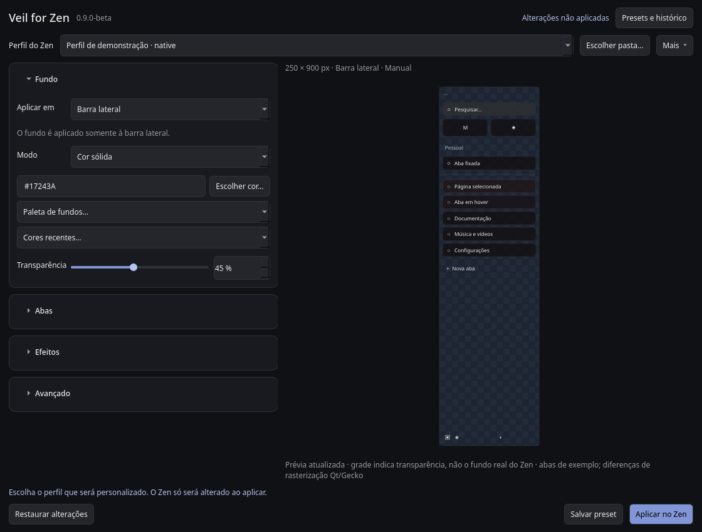
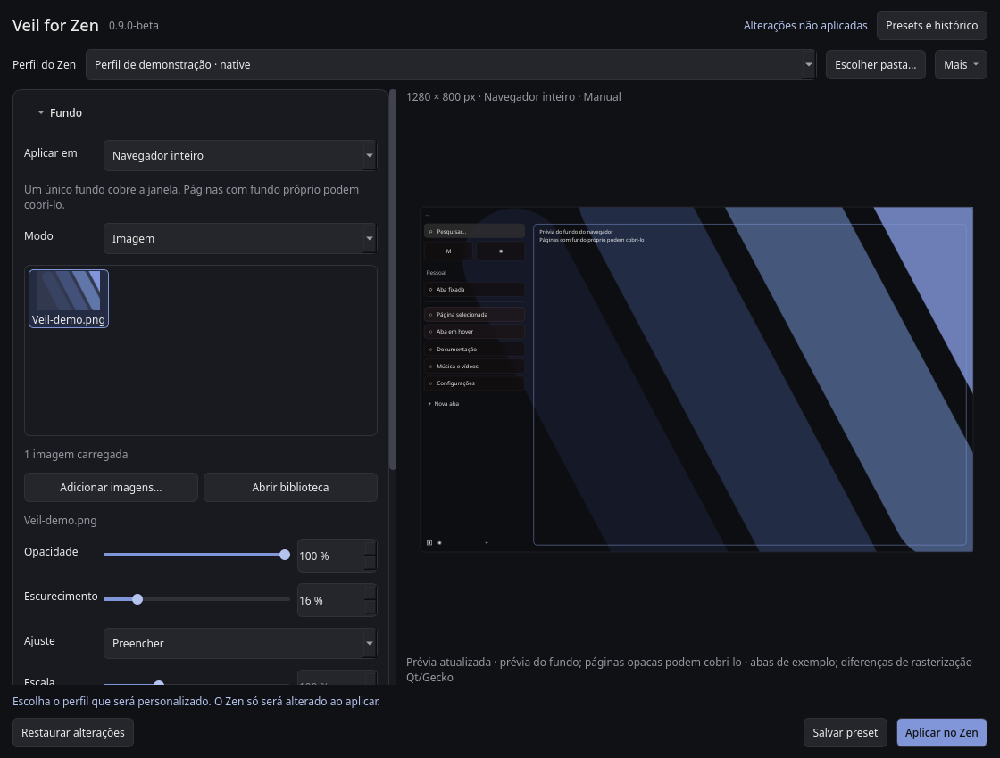

# Veil for Zen

**v0.9.0-beta · beta preparada localmente, ainda sem release pública.** Aplicativo independente para personalizar o fundo da barra lateral ou da janela inteira do Zen Browser no Linux, além das cores das abas. Não é uma extensão oficial e não é desenvolvido ou mantido pela equipe do Zen.





Capturas da interface Qt com perfil fictício e imagem geométrica própria; não são capturas de uma página real do Zen.

## Funcionalidades

- Destino selecionável: **Barra lateral** ou **Navegador inteiro**, com uma imagem contínua no fundo da janela.
- Fundo de imagem ou cor sólida, com hexadecimal, seletor visual, cores recentes, paletas e transparência de 0 a 100%.
- Biblioteca com importação por arquivo ou arrastar e soltar, miniaturas em cache e carregamento em lotes de 48 imagens.
- Opacidade, escurecimento, blur, brilho, contraste, escala e posição da imagem.
- Abas com paletas automáticas, prontas ou personalizadas; bordas, preenchimento e intensidade.
- Prévia assíncrona, com proporções preservadas e divisória ajustável. Em janelas estreitas, os painéis ficam empilhados.
- Perfis nativos e Flatpak descobertos por `profiles.ini`, com seleção manual como alternativa.
- Presets de aparência portáteis com imagem incorporada, separados do histórico local.
- Aplicação explícita, backup, desativação e restauração com detecção de alterações externas.

## Requisitos

Linux, Python 3.11 ou posterior, PySide6 `>=6.10,<6.13` e Zen Browser instalado com um perfil inicializado. Imagens: PNG, JPEG, WebP e BMP, inclusive arquivos sem extensão; limite de 100 megapixels. A integração com Hyprland é opcional. Não precisa de internet durante o uso normal.

O alvo inicial é Arch Linux/Omarchy. Outros desktops Linux e instalações do Zen precisam de validação manual; veja [os resultados e pendências](docs/VALIDATION.md).

## Arch Linux / Omarchy

Não há pacote publicado no AUR. Após obter os artefatos da candidata, coloque `PKGBUILD` e `veil-for-zen-0.9.0-beta.tar.gz` na mesma pasta e execute:

```bash
makepkg -si
```

Dependências de construção: `base-devel`, `python-setuptools`, `python-installer`. O pacote declara `python` e `pyside6` como dependências de execução. A instalação não toca em perfis do navegador. O `PKGBUILD` completo, com hash real, é gerado em `dist/`; o modelo em `packaging/` exige preparar primeiro os artefatos.

Para preparar a partir do código:

```bash
python tools/prepare_release.py
```

## Outras distribuições: ambiente Python isolado

Instale Python 3.11+ com suporte a `venv`/pip, as bibliotecas de desktop exigidas pelo Qt e execute, na pasta extraída do projeto:

```bash
./tools/install-local.sh
```

O script cria um ambiente virtual exclusivo, instala as dependências Python automaticamente e registra o comando e o atalho. Não usa `sudo pip`. A primeira instalação exige acesso ao índice Python. Se sua distribuição separar `venv` em outro pacote, instale esse componente pelo gerenciador da distribuição.

Abra **Veil for Zen** no menu ou execute:

```bash
~/.local/bin/veil-for-zen
```

O ambiente fica em `$XDG_DATA_HOME/veil-for-zen/runtime` (padrão `~/.local/share/veil-for-zen/runtime`). Uma instalação completa com download das dependências ainda precisa ser validada fora do ambiente de desenvolvimento.

## Primeiro uso e perfis

1. Se houver dados antigos do Zen Sidebar Studio, escolha se deseja copiar para o Veil. Os originais permanecem intactos.
2. Confira o perfil no seletor superior. Havendo apenas um perfil detectado, ele será sugerido; com vários, escolha explicitamente. Passe o mouse para consultar o caminho completo.
3. Se nenhum perfil aparecer, abra `about:profiles` no Zen e selecione sua **pasta raiz** em **Escolher pasta…**. Ela deve conter `prefs.js` e permitir escrita.
4. Em **Fundo → Aplicar em**, escolha **Barra lateral** ou **Navegador inteiro**. Depois escolha **Imagem** e adicione fundos, ou use **Cor sólida**. Ajuste as abas se desejar.
   No modo de cor sólida, **Transparência** vai de 0% (opaco) a 100% (sem cor de fundo). A grade da prévia indica transparência; o resultado revela as camadas abaixo da barra no Zen. Ao aplicar um valor acima de zero, o Veil habilita `zen.widget.linux.transparency` e `browser.tabs.allow_transparent_browser` no perfil selecionado e remove as camadas nativas que encobrem a barra. É necessário reiniciar o Zen. O compositor ainda precisa suportar janelas com alfa; o Veil não reduz a opacidade da janela inteira nem torna sites transparentes. Abas e controles mantêm sua proteção de contraste. O ajuste é independente da opacidade da imagem e fica salvo em configurações e presets. Com **Navegador inteiro**, imagem, cor e transparência cobrem um único fundo global; não se repetem separadamente na barra. Os fundos nativos que cobririam essa camada são removidos, inclusive a base de conteúdo que podia criar um contorno claro. Páginas e páginas de nova aba com fundo próprio continuam cobrindo o fundo: o Veil não injeta estilos em sites para removê-lo. Em **Avançado**, as dimensões da prévia da janela ficam separadas das dimensões da barra; alternar o destino preserva ambos os ajustes.
5. Clique em **Aplicar no Zen** e reinicie o navegador manualmente.

A descoberta procura `~/.config/zen`, `$XDG_CONFIG_HOME/zen`, `~/.zen` e locais conhecidos do Flatpak, incluindo `~/.var/app/app.zen_browser.zen/.zen`. Caminhos personalizados declarados em `profiles.ini` são aceitos. Somente o perfil selecionado é alterado. Verificar `prefs.js` identifica uma pasta de perfil Mozilla; a seleção manual depende de você confirmar que é um perfil do Zen.

## Migração e armazenamento

O lançador antigo `python studio.py` continua disponível. Para indicar outra instalação anterior:

```bash
veil-for-zen --legacy-dir /caminho/zen-sidebar-studio
```

A migração é oferecida antes de existirem dados do Veil. Copia configurações, biblioteca `fn_zen`, imagens referenciadas, presets e histórico, mantendo uma cópia dos JSON originais. Não substitui dados novos existentes. Uma imagem antiga ausente permanece referenciada para você escolher uma substituta.

| Conteúdo | Diretório padrão |
|---|---|
| Configuração | `~/.config/veil-for-zen/settings.json` |
| Imagens, presets e histórico | `~/.local/share/veil-for-zen/` |
| Backups por perfil | `~/.local/share/veil-for-zen/backups/` |
| Miniaturas | `~/.cache/veil-for-zen/thumbnails/` |

`XDG_CONFIG_HOME`, `XDG_DATA_HOME` e `XDG_CACHE_HOME` substituem as respectivas raízes quando contêm caminhos absolutos. Nenhum dado mutável é gravado na instalação. O schema de configurações 2 é mantido com campos adicionais compatíveis; configurações 1/2 são normalizadas sem apagar seus originais.

## Presets

**Salvar preset** cria uma aparência nomeada. Em **Presets e histórico**, selecione a categoria para carregar presets ou estados anteriores. Presets podem ser renomeados, excluídos, importados e exportados. Carregar não escreve no Zen: revise e aplique.

A exportação remove o perfil pessoal e incorpora a imagem (até 20 MB). A importação valida o JSON e o conteúdo da imagem, copiando-a para os dados do Veil. O perfil atualmente selecionado é mantido ao carregar. Presets antigos com imagens ausentes pedem uma substituta no modo de imagem. Excluir um preset não exclui imagens nem backups. O histórico de aparência é independente dos backups dos arquivos do navegador.

## CSS, desativação e restauração

O Veil cria `chrome/veil-for-zen.css`, uma imagem independente em `chrome/backgrounds/` com referência relativa ao perfil quando necessário e um import em `chrome/userChrome.css`. Pode habilitar `toolkit.legacyUserProfileCustomizations.stylesheets` por um bloco identificado em `user.js`; nunca edita `prefs.js`. A transparência nativa usa um bloco separado com os valores anteriores registrados. Ao desativar, voltar a fundo opaco/imagem ou restaurar um snapshot anterior à transparência, o Veil escreve os valores anteriores para o próximo início do Zen. Esses overrides de restauração são mantidos em `user.js`, pois apenas remover uma preferência não desfaz o valor que o navegador já persistiu.

Arquivos existentes são copiados antes da gravação. Escritas são atômicas por arquivo; um erro tenta reverter apenas os arquivos já escritos que não sofreram edição externa. A transação não é atomicamente única entre vários arquivos: uma queda abrupta pode exigir recuperação pelo backup. O Veil não encerra o Zen.

- **Mais → Desativar personalização:** remove apenas o import gerenciado, preservando outros estilos. Mantém CSS, imagens e preferência de estilos locais para não prejudicar outros mods; restaura as preferências nativas de transparência que alterou, sem apagar configurações externas.
- **Mais → Restaurar último backup** (ou **Restaurar outro backup…** para selecionar um snapshot anterior): recupera o estado imediatamente anterior à última operação concluída. Recusa a restauração se algum arquivo tiver sido editado depois, evitando destruir alterações externas. A restauração também gera um backup, permitindo desfazê-la.

Imports ativos do antigo `zen-sidebar-studio-v2.css` são substituídos somente quando seu arquivo tem o marcador reconhecido do Studio. O arquivo antigo é preservado e o backup recupera o import anterior. Outros mods são preservados nos arquivos; regras CSS conflitantes ainda podem afetar a aparência.

## Desinstalação

Primeiro, desative a personalização pelo Veil e reinicie o Zen. Depois:

```bash
# Pacote Arch
sudo pacman -R veil-for-zen

# Instalação isolada, a partir da pasta do projeto
./tools/uninstall-local.sh
```

Dados pessoais e perfis do Zen são preservados. Para limpar os dados opcionais, após guardar os presets/backups desejados, remova **somente** as pastas `veil-for-zen` nas raízes XDG de configuração, dados e cache. Não apague o perfil do Zen. Os arquivos de CSS e imagens inativos podem continuar no perfil sem efeito.

## Solução de problemas e limites

- **Perfil não encontrado:** inicialize o Zen ao menos uma vez e use a pasta raiz indicada em `about:profiles`.
- **Permissão negada:** escolha um perfil do seu usuário com permissão de escrita. Não execute o Veil como root.
- **Estilo não aparece:** confirme o perfil, reinicie o Zen e verifique conflitos com outros mods. Seletores internos do Zen podem mudar entre versões.
- **Ícones e pesquisa pouco visíveis:** o Veil define cores claras, sombra discreta nos ícones nativos e proteção escura no campo de pesquisa, inclusive fora do titlebar. Favicons não recebem filtros de cor. Reinicie o Zen após aplicar.
- **Imagem estranha ao deixar transparente:** se Transparent Zen estiver com seu fundo decorativo ativado, o Veil neutraliza essa camada enquanto controla o fundo (modo transparente ou navegador inteiro), preservando os arquivos e preferências do mod. Ao desativar o Veil, a configuração original do outro mod volta a valer.
- **Edição externa detectada:** preserve sua edição e consulte os snapshots em `backups/`; não substitua arquivos para forçar uma restauração.
- **Prévia diferente:** as abas da prévia são exemplos. Qt e Gecko renderizam filtros de forma diferente. Dimensões manuais representam a área CSS da barra ou da janela, conforme o destino escolhido. O Veil não altera as dimensões reais da barra.
- **Automático:** o Veil consulta dimensões persistidas e, opcionalmente, Hyprland; não tem acesso ao DOM do navegador e não promete medir a barra com exatidão.
- **Cor por site/favicon:** não implementada; o CSS gerado não recebe um domínio confiável nem extrai cores de favicons.
- **Flatpak:** descoberta de perfis implementada; imagens aplicadas são copiadas para o perfil para reduzir problemas de acesso. O aplicativo Veil ainda não é distribuído como Flatpak; permissões e comportamento no Zen Flatpak aguardam teste real.
- **Cache e backups:** caches em memória são limitados; miniaturas e backups em disco não têm expiração automática nesta beta. O cache pode ser removido com o aplicativo fechado.

## Desenvolvimento e publicação

```bash
QT_QPA_PLATFORM=offscreen QT_QPA_PLATFORMTHEME= python -m unittest discover -s tests -v
python tools/benchmark.py /caminho/para/biblioteca
python tools/build.py --wheel
```

Veja [CHANGELOG](CHANGELOG.md), [contribuição](CONTRIBUTING.md), [validação](docs/VALIDATION.md), [performance](docs/PERFORMANCE.md) e [notas da candidata](docs/RELEASE-0.9.0-beta.md).

Licenciado sob [MIT](LICENSE); consulte também [NOTICE](NOTICE.md) para dependências e conteúdo de terceiros. Nenhuma informação pessoal de mantenedor foi inserida. A publicação, a tag remota, a release e o envio ao AUR não são automáticos.
