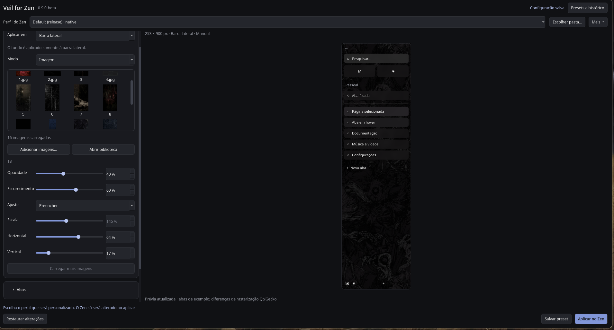
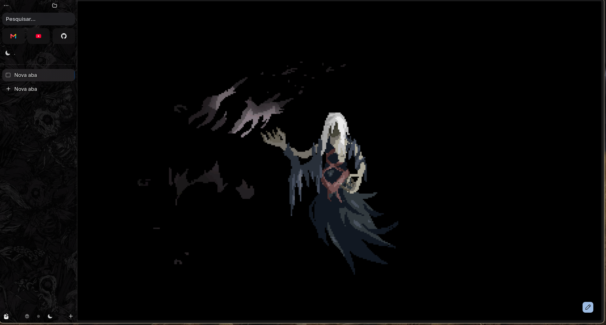

# Veil for Zen

Uma ferramenta para personalizar a aparência do Zen Browser no Linux, sem precisar editar arquivos CSS manualmente.

O Veil permite usar imagens ou cores sólidas como fundo da barra lateral ou do navegador inteiro, ajustar transparência e efeitos, personalizar as abas e visualizar o resultado antes de aplicar.

## Prévia

**Barra lateral**

**Resultado no navegador**

*A primeira imagem mostra a prévia no Veil; a segunda mostra o resultado aplicado no Zen Browser.*

## Funcionalidades

- Imagens ou cores sólidas na barra lateral ou no navegador inteiro.
- Transparência do fundo, com suporte dependente do compositor e do Zen.
- Ajustes de opacidade, escurecimento, desfoque, brilho, contraste, escala e posição.
- Cores, bordas e preenchimentos personalizados para as abas.
- Biblioteca de imagens, presets e prévia em tempo real.
- Aplicação manual com backups e opção de restauração.

## Como funciona

Desenvolvido em Python e PySide6, o Veil aplica estilos CSS ao perfil do Zen selecionado. As mudanças só são gravadas quando você escolhe **Aplicar no Zen**; depois, é necessário reiniciar o navegador.

No modo de navegador inteiro, páginas com fundo próprio podem cobrir a imagem ou cor escolhida. A transparência também depende do suporte do ambiente gráfico.

## Estado do projeto

**v0.9.0-beta — projeto pessoal em desenvolvimento.**

Atualmente utilizado no Arch Linux com Omarchy. Ainda não há uma versão pública para instalação, e a compatibilidade com outros ambientes Linux precisa ser validada.

O Veil for Zen é independente e não possui vínculo oficial com o Zen Browser.
