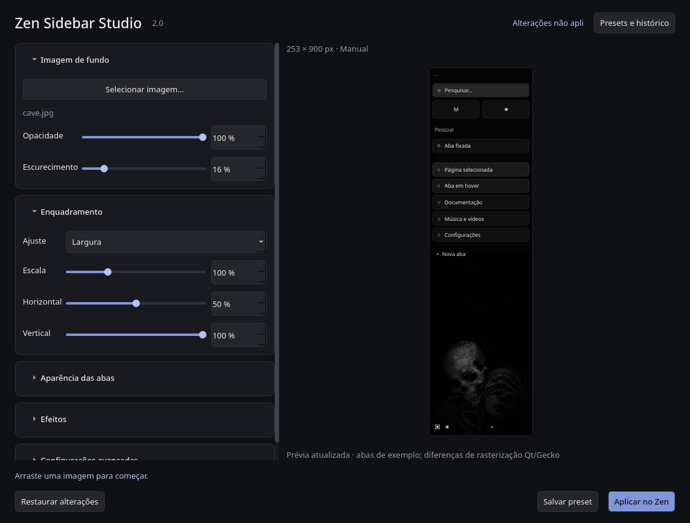

# Zen Sidebar Studio 2.0

Aplicativo local em Python/PySide6 para personalizar o fundo e as cores da
barra lateral do Zen Browser. Abra **Zen Sidebar Studio** no menu de aplicativos
ou execute `python studio.py` nesta pasta. Não é uma extensão nem um mod
publicado na loja do Zen. Não precisa de acesso à internet em execução.



## Como usar

1. Escolha uma das miniaturas da biblioteca **fn_zen**. Para incluir novos fundos,
   copie arquivos para essa pasta, use **Adicionar imagens…** ou arraste arquivos
   para a janela. A inclusão copia a imagem para a biblioteca, preservando o original.
2. Ajuste a imagem e o enquadramento. As seções **Aparência das abas**,
   **Efeitos** e **Configurações avançadas** são recolhíveis.
3. Nas configurações avançadas, informe a largura e a altura **CSS da área de
   fundo da barra**, em pixels. O valor inicial é manual, não uma medição.
4. Escolha uma paleta, seu estilo e intensidade. Clique em uma amostra para
   escolher a cor em uso; as outras cores ficam disponíveis para seleção.
5. Clique em **Aplicar no Zen**. Feche completamente e reabra o Zen para carregar
   o CSS. O painel não fecha o navegador automaticamente.

O indicador no cabeçalho mostra mudanças não aplicadas. **Restaurar alterações**
volta à última configuração salva, sem escrever no perfil. Salvar um preset
não aplica a configuração. Reabra o Studio após atualizar a partir da versão 1.

### Biblioteca de imagens

`fn_zen/`, na raiz deste projeto, é a pasta principal dos fundos. O painel exibe
suas imagens como opções com miniaturas, sem precisar informar um caminho.
Arquivos sem extensão também são reconhecidos pelo conteúdo; arquivos que não
são imagens são ignorados. **Abrir fn_zen** abre a pasta no gerenciador de arquivos.
A lista acompanha alterações na pasta e nas imagens; miniaturas são carregadas
em segundo plano. A pasta usa apenas arquivos diretamente dentro dela, sem subpastas.
Adicionar uma imagem com nome já existente preserva a anterior e gera um nome
alternativo. Configurações e presets antigos com imagens externas continuam
compatíveis; basta escolher uma miniatura para passar a usar a biblioteca.

A aplicação no Zen continua criando uma cópia independente dentro do perfil,
para o navegador carregar o fundo mesmo quando o Studio está fechado. Mudar uma
opção no painel requer **Aplicar no Zen** e reiniciar o navegador para ter efeito.

## Enquadramento e dimensões

- **Largura:** mantém a proporção e permite escala de 20% a 300% da largura.
- **Conter:** mostra a imagem inteira dentro da área configurada.
- **Preencher:** ocupa toda a área, com recorte quando as proporções diferem.
- **Esticar:** ocupa toda a área e pode deformar a imagem.

A posição usa a mesma regra de
[background-position do CSS](https://developer.mozilla.org/en-US/docs/Web/CSS/background-position):
`deslocamento = (tamanho da área − tamanho renderizado da imagem) × posição / 100`.
Ela funciona também quando o espaço restante é negativo (recorte).

**Ajustar prévia à janela** reduz apenas a apresentação visual. O cálculo usa
sempre a largura e altura virtuais configuradas. Desmarcar permite ver 1:1 com
rolagem. Redimensionar a janela do Studio não altera o enquadramento.

### Automático: limites honestos

O painel consulta `hyprctl -j clients` (somente leitura, com timeout) para
localizar o Zen e lê `xulstore.json` do perfil para encontrar a largura persistida
de `navigator-toolbox`. Essa largura pode estar desatualizada e inclui o toolbox,
não necessariamente o retângulo interno pintado; a altura interna não é exposta
por esse arquivo. O tamanho da janela externa **nunca** é usado como largura
ou altura da barra.

Sem uma ponte para o DOM do Zen, nenhuma dessas fontes comprova as duas medidas
internas atuais. Portanto, **Automático** mostra os dados disponíveis e usa
explicitamente as medidas **manuais** como fallback. Não inicia servidores de
inspeção, injeta scripts, altera o navegador ou promete uma detecção inexistente.
É possível usar o Browser Toolbox do Zen para medir o retângulo de
`#titlebar > #zen-toolbar-background`, mas isso não é obrigatório para operar
os controles; medidas manuais continuam disponíveis.

## Fidelidade e desempenho da prévia

O enquadramento, opacidade, escurecimento e ordem dos filtros seguem o CSS
gerado. O blur é uma convolução gaussiana separável com núcleo de até três
sigmas, acumulada em imagens de 16 bits para preservar brilho e transparência.
O [blur CSS](https://developer.mozilla.org/en-US/docs/Web/CSS/filter-function/blur)
também é gaussiano, mas o rasterizador Qt não é o Gecko: podem ocorrer diferenças
nas bordas, arredondamentos, fontes, composição de filtros e backdrop-filter.

O vidro dos controles é renderizado sobre uma versão desfocada do fundo. As
abas fictícias incluem essenciais, fixada, selecionada, hover e normais, com
margens e alturas próximas às regras instaladas do Zen (normal ~34 px; essenciais
~44–46 px). Não há captura da sessão real. Abas, títulos, barra de endereço e
controles podem diferir conforme versão, zoom da interface e outros mods.
O efeito nativo de favicon das essenciais, quando habilitado no Zen, é preservado.

As imagens são decodificadas com orientação EXIF e cache. Para limitar memória,
o processamento da prévia usa imagem-fonte de até 2400 px no maior eixo e canvas
de até 1400 px no maior eixo. A geometria continua baseada nas medidas virtuais;
pode haver perda de detalhe na prévia, não no arquivo aplicado. A exportação
normaliza a orientação em PNG sem a redução de resolução da prévia.
Arquivos acima de 100 megapixels ou recusados pelo decodificador Qt são rejeitados.

Filtros e extração de cores rodam em workers, com debounce e descarte de resultados
antigos; o paintEvent só desenha as imagens prontas. Não há NumPy, Pillow ou
pacotes extras além de PySide6.

## Cores das abas

**Automática:** um histograma ponderado extrai até quatro famílias dominantes,
reduzindo a influência de extremos claros/escuros, transparência e saturação alta.
As cores são suavizadas. **Atualizar paleta da imagem** refaz a análise.

**Personalizada:** Vinho escuro, Azul noturno, Cinza neutro, Verde floresta ou
edição manual da cor em uso pelo seletor Qt. Ao pintar, saturação e luminosidade
são limitadas para manter o aspecto suave, inclusive para uma cor manual intensa.

Os estilos são **Bordas discretas**, **Preenchimento suave** e **Combinado**,
com intensidade de 0 a 100% (padrão 30%). Zero remove a cor; preserva o fundo
neutro de legibilidade. A proteção do texto é graduada sobre um mínimo escuro
para manter contraste mesmo com wallpaper claro. Seleção e hover têm fundos
e intensidades próprias; o texto usa branco suave e sombra.

A cor em uso se aplica uniformemente às abas; não são atribuídas cores por ordem
ou por suposto domínio. Foram inspecionados no `omni.ja` do Zen instalado:

- `tabbrowser/tab.mjs`: estados `selected` e `visuallyselected`;
- `zen-tabs/vertical-tabs.css`: `.tabbrowser-tab`, `.tab-background`, `[pinned]`,
  `[zen-essential]`, posicionamento e efeitos nativos;
- `browser.xhtml`: `#navigator-toolbox`, `#titlebar`, `#zen-toolbar-background`.

**Por site não está disponível.** CSS de userChrome não analisa as cores de um
favicon nem recebe um atributo de domínio estável para todas as abas. A URL do
favicon pode ser um dado embutido, cache, proxy ou outro host, e títulos são
arbitrários. Regras por esses valores produziriam falsas associações. Uma futura
ponte privilegiada para metadados de abas exigiria outra arquitetura; não foi
simulada aqui. Layout, navegação, fixação e essencialidade não são alterados.

## Presets e histórico

**Salvar preset** armazena imagem, filtros, posição, escala, dimensões, paleta,
cor em uso, intensidade e estilo das abas. Em **Presets e histórico**, você pode
carregar, renomear e excluir presets. Exclusão pede confirmação e não remove a
imagem, o histórico ou backups.

Ao aplicar no Zen, as configurações anterior e nova entram no histórico.
Carregar uma entrada restaura os controles; é preciso aplicar para alterar o
Zen. O perfil atual é preservado ao carregar presets, evitando redirecionar a
escrita silenciosamente. Imagens ausentes podem ser substituídas pelo seletor.
Versões futuras/incompatíveis ou arquivos inválidos são rejeitados com mensagem,
sem apagar o arquivo original. O histórico da interface começa com a versão 2;
os backups antigos da versão 1 continuam intactos no perfil.

## Arquitetura e compatibilidade

- `studio.py`: entrada e ajustes locais para Qt/Wayland.
- `core/settings.py`: esquema versão 2, migração da versão 1, validação e escrita atômica.
- `core/rendering.py`: geometria CSS, cache e efeitos de imagem.
- `core/image_library.py`: descoberta, miniaturas e importação segura em fn_zen.
- `core/color_extractor.py`: extração de paletas e cores dos estados das abas.
- `core/zen_integration.py`: leitura de medidas, geração de CSS e aplicação com backup.
- `core/presets.py`: presets e histórico.
- `ui/main_window.py`: fluxos, feedback, arrastar/soltar e biblioteca.
- `ui/controls_panel.py`: seções e controles.
- `ui/preview.py`: desenho e agendamento de workers.
- `ui/theme.py`: tema visual.
- `chrome.css`: template do CSS aplicado, não destinado a importação direta.
- `settings.json`: configuração do usuário; migração acontece em memória e só é
  persistida ao aplicar. Os controles antigos, inclusive blur em décimos de px,
  continuam compatíveis.
- `assets/v1-backup/`: cópia do código e configurações encontrados no início da atualização.

O perfil anterior continua como padrão; é possível escolher outro pela interface.
O aplicativo mantém Python e PySide6, já instalados nesta máquina. O atalho
existente no menu continua válido. Não altera configuração global do Hyprland,
Omarchy, transparência do desktop ou estilos de sites.

## Escrita no perfil e recuperação

Somente **Aplicar no Zen** modifica o perfil:

1. Valida imagem, perfil (`prefs.js`) e destinos, recusando links simbólicos nos
   arquivos gerenciados ou pastas chrome/backgrounds.
2. Cria `sidebar-studio-backups/<timestamp>/`, com CSS/imports anteriores,
   `user.js` anterior se existir e snapshot JSON dos ajustes.
3. Grava uma cópia PNG da imagem com nome baseado no hash do conteúdo em
   `chrome/backgrounds/zss-<hash>.png`.
4. Grava `chrome/zen-sidebar-studio-v2.css` e adiciona seu import ao
   `chrome/userChrome.css`. Preserva o conteúdo original e eventual `@charset`.
   Não duplica imports nem remove regras/imports da versão 1 ou de terceiros.
5. Se necessário, acrescenta a preferência que habilita estilos locais em
   `user.js`, preservando as outras preferências. Não modifica `prefs.js`.

O CSS usa variáveis `--zss-*` e seletores restritos à barra, com precedência sobre
a configuração antiga do Studio. Arquivo homônimo sem assinatura do Studio é
preservado e causa erro, em vez de ser sobrescrito. Gravações usam arquivo
temporário + `fsync` + substituição atômica por arquivo. Erros durante a instalação
restauram os arquivos anteriores. Não é uma transação entre arquivos à prova de
queda de energia; em caso de interrupção forçada, o backup permanece disponível.
Backups e imagens antigos não são removidos automaticamente.

Para reverter o resultado visual sem editar CSS, carregue uma entrada anterior
no histórico e aplique. Para remover completamente a versão 2, remova o import
`@import url("zen-sidebar-studio-v2.css");` do userChrome e reinicie. A versão 1,
se ainda importada, voltará a aparecer. Não remova arquivos de terceiros.

## Testes

```bash
QT_QPA_PLATFORM=offscreen QT_QPA_PLATFORMTHEME= python -m unittest discover -s tests -v
python -m compileall -q studio.py core ui tests
```

A suíte usa imagens sintéticas e perfis temporários: migração, entradas inválidas,
geometria em diferentes proporções, composição dos filtros, conservação de brilho
no blur, paletas, estados de abas, presets/histórico, imagens ausentes, geração
de CSS, preservação de terceiros, rollback de falha simulada, fallback de
medidas, inicialização e redimensionamento da interface. Nenhum teste escreve no
perfil real. A inspeção estática de CSS verifica variáveis, blocos e seletores;
não substitui um parser Gecko.

A validação visual no Zen real continua necessária para conflitos com outros
mods, efeitos nativos de essenciais, zoom, barra recolhida/compacta e diferenças
de renderização. A detecção interna exata continua indisponível. Não foi prometida
fidelidade absoluta nem associação automática de cores por domínio.
